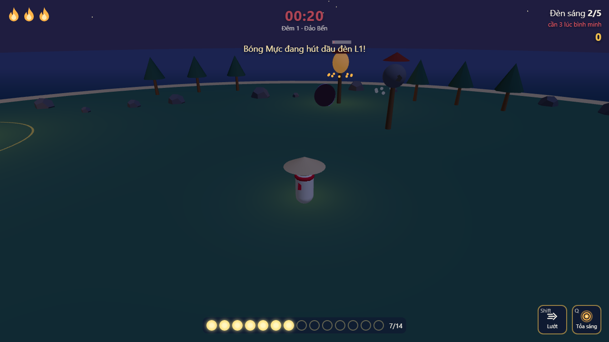

# Đảo Đèn Lồng — v1.0.0

> 🎬 **Video demo:** _(chưa có — sẽ đính kèm Release [v1.0.0](../../releases/tag/v1.0.0) hoặc `docs/demo/demo.mp4`)_
> Day 12 · AI SDLC Lab · Tác giả: Mai Văn Thành (2A202603696) · Tài liệu của lab: [docs/lab/](docs/lab/)

Game 3D góc nhìn thứ ba. Bạn là **Mây**, người giữ đèn nhỏ tuổi đội nón lá. Qua **3 Đêm, 3 hòn đảo** (Đảo Bến, Đảo Cau, Đảo Chuông), gom đom đóm, thắp đèn và **giữ đảo sáng tới bình minh**. Đèn cạn dầu sẽ tắt. Bóng Mực tím đen hút dầu đèn yếu, Gió Lạc cướp đom đóm.


| | |
|---|---|
|  |  |

## Yêu cầu hệ thống

- **Node.js ≥ 22** (macOS, Linux hoặc Windows). Không cần công cụ build nào khác.
- Trình duyệt có WebGL: Chrome/Edge/Firefox/Safari bản mới. Bench cần **Chrome, Chromium hoặc Edge** (tự dò, hoặc `--chrome <đường dẫn>`).
- Máy tham khảo: i5-8265U + Intel UHD 620 (GPU tích hợp), 8 GB RAM, đạt khoảng 123 FPS trong bench.

## Cài đặt & chạy (3 lệnh)

```bash
cd K5-L3A-LAB-Day12-MaiVanThanh-2A202603696-AI-SDLC-Dao-Den-Long   # thư mục vừa clone
npm install        # build_cmd (chỉ tải three.js)
npm start          # run_cmd → mở http://localhost:5173
```

Không muốn cài Node: dùng Docker (xem [Dockerfile](Dockerfile)) hoặc file zip trong [Release v1.0.0](../../releases/tag/v1.0.0) (đã kèm three.js; chỉ cần `node server.js`).

## Điều khiển (đổi được trong Cài đặt)

| Phím mặc định | Hành động |
|---|---|
| `W A S D` | Di chuyển theo hướng camera |
| Chuột (bấm vào màn hình để khóa chuột) · `Z` / `C` | Xoay camera |
| `Space` | Nhảy |
| `Shift` | Lướt (14 m/s trong 0.2 s, hồi 1.5 s) |
| `E` | Nạp ánh sáng / thắp lại / châm dầu ở đèn gần nhất (trong 2 m) |
| `Q` / chuột trái | Tỏa Sáng: tốn 3 đom đóm, choáng và đẩy lùi Bóng Mực trong 5 m |
| `P` / `Esc` | Tạm dừng: Tiếp tục / Chơi lại Đêm / Cài đặt / Về menu |
| `F3` | Hiện FPS |

**Cài đặt** (được lưu): âm lượng, độ nhạy chuột, **đổi phím** cho mọi hành động (báo phím trùng, nút "Khôi phục mặc định"), **bảng màu dễ phân biệt** (mù màu), **phụ đề và chỉ báo hình ảnh** (Bóng Mực xuất hiện kèm mũi tên ở mép màn hình, gió sắp thổi, 10 s cuối, đèn dưới 30 dầu), **giảm chuyển động** (tắt rung camera và chớp màn hình), **chữ lớn ×1.25** (chữ UI tối thiểu 18 px).

## Luật chơi (Test Contract v1.3)

**Mục tiêu: giữ đảo sáng tới bình minh.** Hết giờ (Đêm 1/2/3: 4:00 / 4:30 / 5:00) mà Mây còn sống và số đèn **đang sáng** ≥ 60 % (3/5, 4/6, 5/7) thì **thắng**. Thiếu đèn hoặc hết 3 Ngọn Lửa thì **thua** (chơi lại Đêm đó).

- **Dầu đèn:** đèn vừa thắp có 100 dầu, cháy 1 dầu/giây, hết dầu thì tắt. Bấm tương tác ở đèn đang sáng để châm dầu (1 đom đóm = 10 dầu). Thắp lại đèn đã từng sáng chỉ cần 5 đom đóm (lần đầu cần 10).
- **Đèn yếu (< 30 dầu)** mất vùng an toàn 6 m. Bóng Mực tìm tới và hút 5 dầu/giây. Tỏa Sáng hoặc châm dầu lên ≥ 30 để đuổi chúng.
- **Sức chứa** 10, tăng 2 mỗi lần thắp thành công, tối đa 20. Bị Bóng Mực chạm: −1 lửa, rơi nửa số đom đóm. Rơi khỏi đảo: −1 lửa, mất hết đom đóm.
- **Gió Lạc** (Đêm 2, 3) cướp 3 đom đóm khi bạn mang ≥ 5. **Bùa Gió**: 10 s chạy 7.2 m/s, lướt không hồi. **Gió mạnh** (Đêm 3) mỗi 30 s.

| Sự kiện | Điểm |
|---|---|
| Mỗi đom đóm nạp vào đèn (thắp, thắp lại, châm dầu) | +5 |
| Thắp lần đầu / thắp lại | +100 / +40 |
| Mỗi Bóng Mực trúng Tỏa Sáng | +5 (tổng +15 nếu nó đang hút dầu) |
| Bình minh (khi thắng): mỗi đèn đang sáng · mỗi Ngọn Lửa | +50 + floor(dầu) · +50 |

Tổng điểm = tổng điểm các Đêm đã thắng. Sau màn **Bình Minh** (thắng Đêm 3) hoặc khi thua, nhập tên (3–12 ký tự, chữ có dấu được) để lưu vào **Bảng xếp hạng** top 10 (menu chính). Mọi con số: [game.contract.json](game.contract.json).

## Kiểm chứng, headless, bench, soak

```bash
npm test                                                    # 69 case (Phase 1–4), mỗi case chạy CLI headless thật
node src/headless.js --seed 1 --night 1 --ticks 3600 --out out.jsonl [--scenario s.json] [--inputs i.json] [--snapshot-every 10]
node scripts/bench.js --seed 42 --duration 30 --out bench.json   # bench_cmd: cửa sổ Chrome 1280×720, vsync tắt
node scripts/soak.js  --seed 7 --nights 10 --out soak.json       # soak_cmd: 10 Đêm trong một tiến trình
npm start -- --export-leaderboard out.json                  # xuất bảng xếp hạng {"entries": [...]}
npm run proof -- 4                                          # bảng truy vết yêu cầu → docs/proof/phase-4/results.md
```

| Kết quả tự đo (máy tham khảo) | Giá trị | Ngưỡng ticket |
|---|---|---|
| [bench.json](bench.json): avg / 1 % low / p95 / load | 123.1 FPS / 36.0 FPS / 12.1 ms / 1747 ms | ≥ 60 / ≥ 30 / — / ≤ 10000 |
| [soak.json](soak.json): crashes, RSS đầu → cuối | 0, 41.6 → 43.3 MB | 0, ≤ 1.2 × |
| Headless 21.600 tick (một Đêm đầy đủ) | ~0.5 s | ≤ 30 s |

Ghi chú bench: vsync tắt bằng `--disable-gpu-vsync --disable-frame-rate-limit`. `peak_mem_mb` là RSS của cả cây tiến trình Chrome. Bench mặc định mở cửa sổ thật; `--headless` chỉ dùng cho CI, không dùng để chấm. Ghi chú soak: script tự chạy lại chính nó với cấu hình bộ nhớ V8 cố định (`--max-semi-space-size=1 --no-opt --no-maglev`), để RSS không bị phần khởi động của V8 làm lệch; `heap_used_*` trong soak.json cho thấy heap JS không tăng.

## Cấu trúc

```
game.contract.json  Test Contract v1.3 (tuning, headless_cmd, bench_cmd, soak_cmd)
src/sim/            luật game tất định (game.js), bản đồ (maps.js), cảnh bench (bench.js), IO contract
src/headless.js     CLI headless · src/leaderboard*.js  bảng xếp hạng (lưu data/leaderboard.json)
server.js           server tĩnh + API bảng xếp hạng + --export-leaderboard
web/                client Three.js: render, HUD, menu, âm thanh WebAudio, cài đặt — không chứa luật
scripts/            bench, soak, proof, bot, ảnh chụp và đo FPS qua Chrome DevTools protocol
tests/              69 case + scenario
docs/spec/ docs/adr/ docs/notes/ docs/proof/   spec + tiêu chí nghiệm thu, ADR, giả định + nhật ký AI + retro, bằng chứng từng phase
docs/lab/           đề bài và quy định của lab
AGENTS.md, CLAUDE.md, .claude/    harness AI (hook chặn khi test đỏ, skill verify)
CHANGELOG.md CREDITS.md LICENSE Dockerfile
```

## Sáng tạo của tôi

Toàn bộ nằm ở `web/`. Headless không import `web/`, nên đầu ra contract không đổi (69/69 case đạt). Trong cảnh bench, cây và đá trang trí bị tắt.

- **Ông Đăng** dẫn chuyện ở màn giới thiệu mỗi Đêm. Nhạc nền và mọi hiệu ứng âm thanh được **tổng hợp bằng WebAudio**, không dùng file.
- Hạt tiến độ trên đèn, vòng sáng đúng bằng bán kính vùng an toàn, đèn lồng nhỏ trên nón Mây sáng theo số đom đóm, khăn đỏ bay theo tốc độ.
- Bóng Mực trồi lên khi mới sinh, xẹp khi bị choáng, nghiêng về phía đèn khi hút dầu. Gió Lạc là dải lụa uốn lượn, phình to khi giữ đồ cướp được. Đom đóm rơi nhấp nháy trước khi biến mất. Chuông trên tháp đung đưa.
